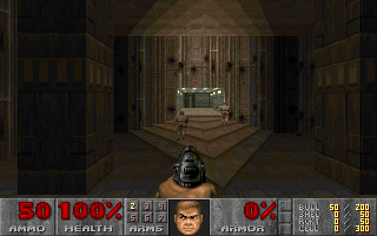
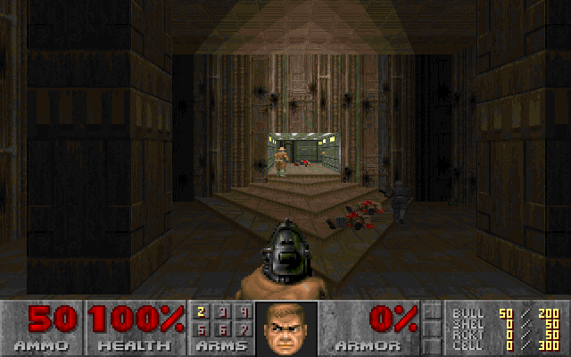
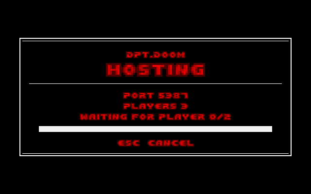
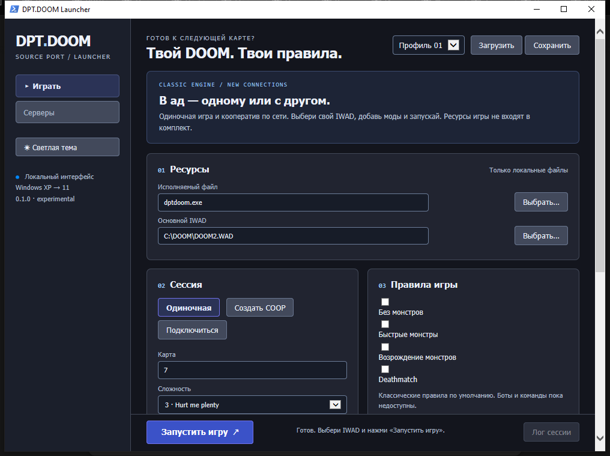
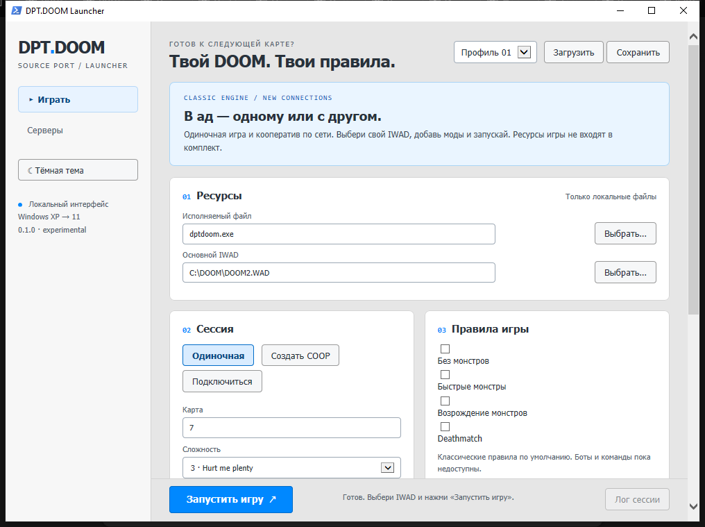

<p align="center">
  
</p>

<h1 align="center">DPT.DOOM</h1>

<p align="center">
  <b>Свой source port Doom на C# — от Windows XP до Windows 11, без единой сторонней библиотеки.</b>
</p>

<p align="center">
  
  
  
  
</p>

---

## Что это

Порт Doom на C#, выросший из [Managed Doom](https://github.com/sinshu/managed-doom)
(перевод Linux Doom на C#) и продолжающий идеи первого DPT.DOOM на C/DoomGeneric.

Ограничение, из которого выросла вся архитектура: **сборка должна работать на
Windows XP** и не тащить за собой ничего. Отсюда свой Win32-бэкенд вместо SDL,
программный рендерер вместо OpenGL, MSHTML вместо WebView2 и свой микшер вместо
стороннего аудио. Рядом с `dptdoom.exe` не лежит ни одного чужого DLL.

## Возможности

| Движок | Сеть | Инструменты |
|---|---|---|
| Программный рендерер: BSP, стены, полы и потолки, спрайты, свет, небо, fuzz, интерполяция кадров | Lockstep-кооператив на 2–4 игроков по TCP | Headless-прогон: хеши мира, кадр в BMP |
| Полная игра: физика, монстры, двери и лифты, оружие, сохранения, демо, DeHackEd, automap, интермиссия | Упреждение ввода: 100 мс пинга — по-прежнему 35 тиков/с | Профайлер кадра по секциям (`-profile`) |
| Boom: обобщённые линии, скроллеры, пушеры, перенос света | Relay — игра без проброса порта и без NAT hairpin | Трасса бота по тикам и карта его пути |
| Свой Win32: `user32` + `gdi32`, `winmm`, MUS → MIDI | Восстановление связи после обрыва | Отладочные оверлеи: блокмап, триггеры |

<p align="center">
  
  
</p>

## Быстрый старт

Нужен .NET SDK 9+ (только для сборки) и свой IWAD. Для разработки положить
Doom II в `refs/iwads/doom2.wad` — папка `refs/` в Git не попадает.

```powershell
dotnet build DPTDOOM.slnx -c Release
.\DPTDOOM\bin\Release\net40\dptdoom.exe -iwad refs\iwads\doom2.wad
```

Или через лаунчер — он сам спросит IWAD и покажет список серверов:

```powershell
.\DPTDOOM.Launcher\bin\Release\net40\dptdoom-launcher.exe
```

## Кооператив и боты

**С другом.** Хост ждёт на порту, гость подключается:

```powershell
dptdoom.exe -iwad doom2.wad -net host -players 2 -port 5029 -warp 1
dptdoom.exe -iwad doom2.wad -net join -address 192.168.1.10:5029
```

Порт пробрасывать не обязательно: с `-relay` хост публикуется на master и
открывает канал наружу, а гость заходит по id сессии. Это же снимает NAT hairpin.
`T` открывает чат, `Enter` отправляет.

**С ботами.** `-coopbots 1..3` добавляет напарников в тот же мир — их видно, они
стреляют, открывают двери и ищут выход. В сетевой игре ботов водит **только хост**,
а их команды идут по сети как команды игроков: гость не считает бота у себя, и
две копии не расходятся.

```powershell
dptdoom.exe -iwad doom2.wad -coopbots 3 -warp 1 -skill 3
```

MAP01 проходят все четыре характера бота — от 0:32 (Sweeper) до 0:59 (Cautious)
на skill 3, ни разу не погибнув. Карты, где единственный путь идёт через лифт или
поднимающийся пол, граф пока не проходит: цифры и честный список ограничений —
в [docs/BOTS.md](docs/BOTS.md).

## Лаунчер

<p align="center">
  
  
</p>

Настоящий HTML/CSS/JS, встроенный в EXE, но рендерит его **MSHTML** — движок
Internet Explorer. WebView2 на Windows XP не ставится, а MSHTML есть в системе
всегда: ни рантайма, ни скачивания, ни интернета. Связь страницы с C# идёт через
навигацию на приватную схему `dptdoom://`, без COM-регистрации.

## Документация

| | |
|---|---|
| [docs/BUILDING.md](docs/BUILDING.md) | сборка, флаги командной строки, отладка, профилирование |
| [docs/NETWORK.md](docs/NETWORK.md) | устройство lockstep, упреждение ввода, обрыв и возврат |
| [docs/BOTS.md](docs/BOTS.md) | как устроены боты, замеры, известные ограничения |
| [docs/MASTER.md](docs/MASTER.md) · [docs/RELAY.md](docs/RELAY.md) | сервер списка сессий и relay |
| [docs/LAUNCHER.md](docs/LAUNCHER.md) | лаунчер: страница, мост, темы |
| [docs/ROADMAP.md](docs/ROADMAP.md) | что сделано, что осталось, что не сработало и почему |
| [docs/CI.md](docs/CI.md) | что проверяет CI |

<details>
<summary><b>Все режимы запуска</b></summary>

```powershell
# Обычная игра
dptdoom.exe -iwad doom2.wad -warp 1 -skill 3

# Хост кооператива
dptdoom.exe -iwad doom2.wad -net host -players 2 -port 5029 -warp 1

# Подключение к хосту
dptdoom.exe -iwad doom2.wad -net join -address 192.168.1.10:5029

# Через relay: без проброса порта
dptdoom.exe -iwad doom2.wad -net host -players 2 -master play.dartpower.xyz:25135 -relay
dptdoom.exe -iwad doom2.wad -net join -relay-master play.dartpower.xyz:25135 -relay-session <id>

# Кооп с ботами
dptdoom.exe -iwad doom2.wad -coopbots 3 -warp 1 -skill 3

# Headless: 70 тиков и кадр в BMP
dptdoom.exe -headless -iwad doom2.wad -warp 1 -tics 70 -shot frame.bmp

# Бенчмарк демо
dptdoom.exe -headless -iwad doom2.wad -timedemo demo1

# Master server с relay
dptdoom-master.exe --bind 0.0.0.0 --port 25135 --relay
```

</details>

<details>
<summary><b>Структура репозитория</b></summary>

```
DPTDOOM/            игра (net40 + net9.0 для тестов)
  src/Doom/         движок: мир, рендер, меню, WAD, DeHackEd
  src/Win32/        окно, ввод, звук, музыка
  src/Headless/     запуск без окна
  src/Net/          lockstep-сессия
DPTDOOM.Shared/     протокол master + клиент списка
DPTDOOM.Master/     сервер списка сессий
DPTDOOM.Launcher/   HTML-лаунчер (Assets/ — сама страница)
DPTDOOMTest/        unit и compatibility тесты
```

</details>

<details>
<summary><b>Тесты и CI</b></summary>

```powershell
dotnet test DPTDOOMTest\DPTDOOMTest.csproj -c Release
powershell -NoProfile -File tools\test-headless.ps1
powershell -NoProfile -File tools\test-bots.ps1
powershell -NoProfile -File tools\test-net-bots.ps1
powershell -NoProfile -File tools\test-net-latency.ps1
powershell -NoProfile -File tools\test-reconnect.ps1
powershell -NoProfile -File tools\test-relay.ps1
powershell -NoProfile -File tools\test-launcher.ps1
powershell -NoProfile -File tools\check-standalone.ps1
```

284 теста. Геймплейные сверяют хеши мира с эталонами Managed Doom — то есть
проверяют, что порт остался демо-совместимым, а не только что он компилируется.
Тесты, которым нужен IWAD, без него помечаются пропущенными, а не падают.

CI (`.github/workflows/ci.yml`) гоняет тесты на Windows и Linux, собирает `net40`,
проверяет обещание «без сторонних библиотек» и кладёт готовый ZIP в артефакты.
Подробности: [docs/CI.md](docs/CI.md).

</details>

<details>
<summary><b>Переносимость</b></summary>

- **net40** — то, что поставляется: Windows XP SP3 и новее.
- **net9.0** — только чтобы гонять тесты на современном SDK.
- `portable.txt` рядом с EXE переключает конфиг и сохранения в `user/`.

</details>

## Лицензия и происхождение

GPL v2 или новее, см. [LICENSE](licenses/LICENSE_DPTDOOM.txt). Проект сохраняет
происхождение Managed Doom (Nobuaki Tanaka), Chocolate Doom и оригинального Doom
от id Software. Игровые данные не включены: **IWAD в комплект не входит**, и
лицензия движка не даёт прав на него.

Скриншоты — настоящие кадры работающего движка и лаунчера: без рабочего стола,
чужих окон и тени окна. Кадры игры снимаются из кадрового буфера
(`tools/capture-game.ps1`), окно — по видимым границам DWM
(`tools/capture-window.ps1`).

<p align="center">
  <sub>Doom — торговая марка id Software. Этот проект не связан с id Software и не одобрен ею.</sub>
</p>
