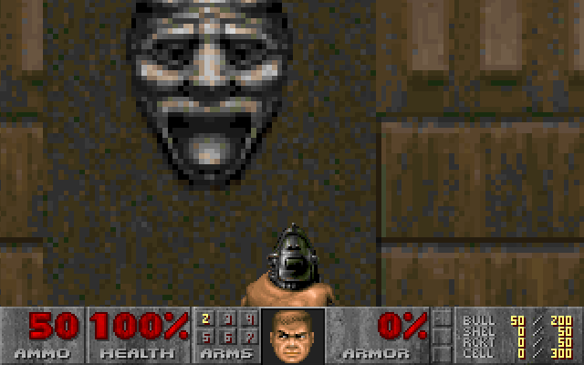
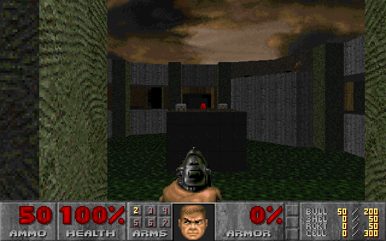
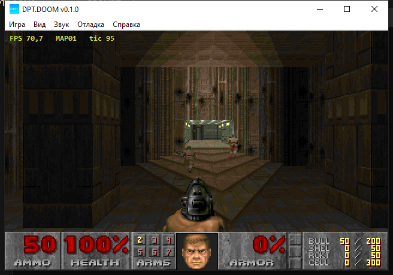

# DPT.DOOM

Свой source port Doom на C#. Основан на [Managed Doom](https://github.com/sinshu/managed-doom)
(перевод Linux Doom на C#) и продолжает идеи первого DPT.DOOM на C/DoomGeneric.
Цель — **полностью standalone** сборка под **.NET Framework 4.0**, включая Windows XP:
без сторонних библиотек, без OpenGL, без WebView2.


## Что уже работает

- **Программный рендерер** — BSP, текстуры стен/полов/потолков, спрайты, свет,
  небо, fuzz, палитровые эффекты, интерполяция кадров.
- **Игра** — физика, монстры, двери/лифты, оружие, сохранения, демо,
  DeHackEd, automap, интермиссия, титры.
- **Свой Win32-бэкенд** — окно через `user32` + вывод кадра через `gdi32`
  (`StretchDIBits`), звук через `winmm` (`waveOut`, свой программный микшер),
  музыка — MUS → MIDI через системный синтезатор. Никаких DLL рядом с EXE.
- **Headless** — прогон без окна, с дампом кадра и хешами мира (для тестов).
- **Кооператив по сети** — lockstep TCP-сессия host/join на 2–4 игроков.
- **HTML-лаунчер** — интерфейс на HTML/CSS/JS внутри EXE.
- **Master server** — нативный сервер списка сессий.

| MAP07 | MAP11 |
|---|---|
|  |  |

Кадры сняты автоматически из кадрового буфера движка (`tools/capture-game.ps1`).
Doom II и его графика принадлежат правообладателям, **IWAD в комплект не входит**.

## Лаунчер

| Тёмная тема | Светлая тема |
|---|---|
|  |  |

Интерфейс — настоящий HTML/CSS/JS, но рендерит его **MSHTML** (движок Internet
Explorer, он же `mshtml.dll`), а не WebView2. Это осознанное решение: WebView2
не устанавливается на Windows XP, а MSHTML есть в системе всегда и не требует
ни рантайма, ни скачивания, ни интернета.

Связь страницы с C# идёт через навигацию на приватную схему `dptdoom://<verb>`:
хост отменяет переход и забирает payload из страницы. Это работает на всех
поддерживаемых версиях Windows и не требует COM-регистрации.

## Меню и трей

| Счётчик кадров и меню |
|---|
|  |

Оконный режим имеет обычное меню Win32 — Игра, Вид, Звук, Отладка, Справка.
Там то, что не выражается клавишами: размер окна, полный экран, громкость,
гамма и отладочные инструменты. Пункты с галочками показывают реальное
состояние. Игра умеет сворачиваться в трей, как программы Windows 3.x.

В меню «Отладка» есть каркас геометрии, режим «только карта», заморозка
монстров, замедление, телепорт по картам, спавн предметов, «убить всех» и
сохранение кадра/лога. Подробности — [docs/BUILDING.md](docs/BUILDING.md).

## Боты

### Кооп с ботами — «я и три напарника»

```powershell
dptdoom.exe -iwad refs\iwads\doom2.wad -coopbots 3 -warp 1 -skill 3
```

Ты играешь за первого игрока, ещё трое — боты в том же мире: их видно, они
стреляют, открывают двери и идут к выходу. Это локальная игра (не по сети), так
что можно тестировать кооп в одиночку.

Число ботов: `-coopbots 1..3` (всего до 4 игроков). Сочетать с `-net` нельзя.

### Бот вместо игрока

```powershell
dptdoom.exe -iwad doom2.wad -bots -warp 1
```

Тут бот управляет **твоим** игроком — удобно, чтобы посмотреть, как он проходит
карту, или прогнать мир под нагрузкой.

### Честное состояние

Бот строит маршрут по графу секторов (Doom не требует nav-меша, он уже есть в
карте), стреляет по видимым целям и идёт к выходу. Но карту до конца он пока
**не проходит**: застревает у части дверных проёмов. Детали, что работает и что
нет — [docs/BOTS.md](docs/BOTS.md).

## Быстрый старт

Нужен .NET SDK 9+ (для сборки) и свой IWAD. Для локальной разработки положить
Doom II в `refs/iwads/doom2.wad` — папка `refs/` в Git не попадает.

```powershell
dotnet build DPTDOOM.slnx -c Release
.\DPTDOOM\bin\Release\net40\dptdoom.exe -iwad refs\iwads\doom2.wad
```

Или через лаунчер:

```powershell
.\DPTDOOM.Launcher\bin\Release\net40\dptdoom-launcher.exe
```

## Режимы запуска

```powershell
# Обычная игра
dptdoom.exe -iwad doom2.wad -warp 1 -skill 3

# Хост кооператива (ждёт игрока на порту)
dptdoom.exe -iwad doom2.wad -net host -players 2 -port 5029 -warp 1

# Подключение к хосту
dptdoom.exe -iwad doom2.wad -net join -address 192.168.1.10:5029

# Headless: 70 тиков и кадр в BMP
dptdoom.exe -headless -iwad doom2.wad -warp 1 -tics 70 -shot frame.bmp

# Бенчмарк демо
dptdoom.exe -headless -iwad doom2.wad -timedemo demo1

# Master server
dptdoom-master.exe --bind 0.0.0.0 --port 25135
```

## Структура

```
DPTDOOM/            игра (net40 + net9.0 для тестов)
  src/Doom/         движок: мир, рендер, меню, WAD, DeHackEd
  src/Win32/        окно, ввод, звук, музыка
  src/Headless/     запуск без окна
  src/Net/          lockstep-сессия
DPTDOOM.Shared/     протокол master + клиент списка
DPTDOOM.Master/     сервер списка сессий
DPTDOOM.Launcher/   HTML-лаунчер (Assets/ — сама страница)
DPTDOOMTest/        unit и compatibility тесты
```

## Тесты

```powershell
dotnet test DPTDOOMTest\DPTDOOMTest.csproj -c Release
powershell -NoProfile -File tools/test-master.ps1
powershell -NoProfile -File tools/test-launcher.ps1
powershell -NoProfile -File tools/check-standalone.ps1
```

Тесты совместимости требуют IWAD; без него они помечаются как пропущенные, а не
падают. Геймплейные тесты сравнивают хеши состояния мира с эталонами Managed Doom,
то есть проверяют, что порт остался демо-совместимым.

## CI

`.github/workflows/ci.yml`: тесты на Windows и Linux, сборка `net40`, проверка
обещания «без сторонних библиотек», тесты master-протокола и лаунчера, и ZIP в
артефактах. Подробности: [docs/CI.md](docs/CI.md).

Артефакт `dptdoom-windows-<commit>.zip` — готовая сборка для друзей: игра, master,
лаунчер, лицензия и исходники этого коммита. IWAD в него не входит.

## Переносимость

- **net40** — то, что поставляется: работает на Windows XP SP3 и новее.
- **net9.0** — только для запуска тестов на современном SDK.
- `portable.txt` рядом с EXE переключает конфиг/сейвы в `user/`.

## Лицензия и происхождение

GPL v2 или новее, см. [LICENSE](licenses/LICENSE_DPTDOOM.txt). Проект сохраняет
происхождение Managed Doom (Nobuaki Tanaka), Chocolate Doom и оригинального Doom
от id Software. Коммерческие игровые данные не включены, лицензия движка не даёт
прав на IWAD.

Подробности: [docs/ROADMAP.md](docs/ROADMAP.md), [docs/BUILDING.md](docs/BUILDING.md),
[docs/LAUNCHER.md](docs/LAUNCHER.md), [docs/MASTER.md](docs/MASTER.md),
[docs/NETWORK.md](docs/NETWORK.md), [docs/BOTS.md](docs/BOTS.md), [docs/CI.md](docs/CI.md),
[docs/REFERENCE-SOURCES.md](docs/REFERENCE-SOURCES.md), [PROMPT.md](PROMPT.md).
