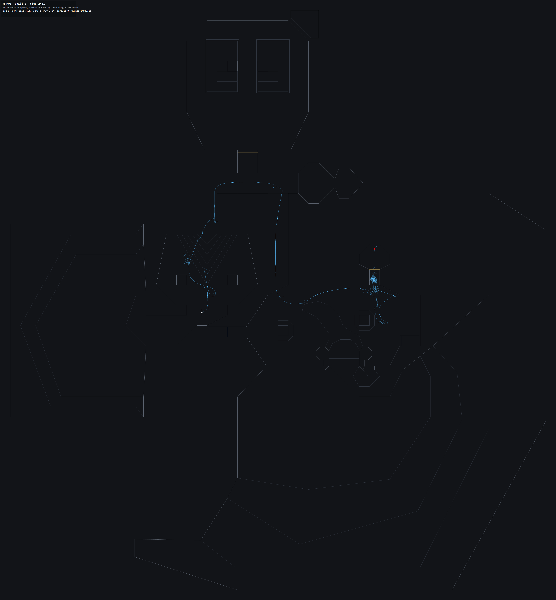

# Боты

## Как запустить

```powershell
# Кооп с ботами: ты и трое ботов в одном мире
dptdoom.exe -iwad doom2.wad -coopbots 3 -warp 1 -skill 3

# Бот вместо игрока: посмотреть, как он проходит карту
dptdoom.exe -iwad doom2.wad -bots -warp 1
```

`-coopbots 1..3`; с `-net` не сочетается (сетевые боты не реализованы).

## Что боты умеют

Бот **сам находит путь до выхода и завершает уровень**. Измерено на MAP01,
один бот, skill 3, headless:

| Стиль | Время | Секторов |
|---|---|---|
| Rush | 0:29 | 15 из 59 |
| Sweeper | 0:33 | 31 из 59 |
| Cautious | 0:42 | 15 из 59 |
| Hunter | 0:56 | 17 из 59 |

Дальше бот:
- стреляет по видимой цели, прицеливается перед выстрелом;
- выбирает оружие под имеющиеся патроны;
- открывает двери (импульсами Use, см. ниже);
- нажимает переключатель выхода и завершает уровень;
- обходит всю карту, если стиль этого требует.

## Навигация

**Doom не требует nav-меша, испечённого редактором**, как в Half-Life и
Counter-Strike: карта уже содержит всё нужное, и меш строится из неё в памяти за
десятки миллисекунд.

| Понятие HL/CS | Что соответствует в Doom |
|---|---|
| nav area | точка внутри сектора (сетка + точки вдоль стен) |
| nav link | прямая между точками, не пересекающая стену |
| портал | двусторонняя линия, соединённая точками с обеих сторон |
| компилятор nav-меша | не нужен: строится при загрузке карты |

На MAP01 получается 813 точек и 7638 связей, покрытие 59 из 59 секторов.

### Четыре ошибки, которые пришлось пройти

Записаны, потому что каждая выглядит разумно и каждая ломалась по-своему.

1. **Субсекторы BSP как узлы.** Субсектор выпуклый, значит его центр всегда
   проходим. Но сегменты субсектора не дают полного списка касающихся линий
   после того, как BSP разрезал длинные линии. Граф связывал 18 узлов из 194.

2. **Секторы как узлы.** Связность верная: двусторонняя линия — это проход. Но
   сектор **не** выпуклый: Г-образный коридор — один сектор, и прямая к
   следующему порталу идёт через угол.

3. **`PointInSubsector` как проверка «внутри сектора».** Главная ловушка. У BSP
   нет понятия «сплошное пространство»: точка в пустоте за односторонней стеной
   всё равно принадлежит какому-то субсектору — и очень часто именно тому,
   который перед стеной. Прямая сквозь стену проходила проверку «тот же сектор,
   чисто», и бот упирался в стену до конца уровня. Настоящая проверка —
   пересечение отрезка с **односторонней** линией.

4. **Рёбра порталов в обе стороны.** Спрыгнуть на 48 единиц вниз можно, залезть
   обратно нельзя. Двустороннее ребро позволяло боту спланировать маршрут,
   который спускается в яму и пытается подняться обратно. Рёбра порталов
   **направленные**.

### Проходимость

- Шаг вверх больше 24 единиц — нельзя (вниз можно).
- Просвет меньше 56 единиц (рост игрока) — нельзя.
- Двери и лифты — исключение: они открываются.
- Линия видимости проверяется **полосой** ±16 единиц: игрок шириной 32, и
  прямая, пролезающая в щель уже него, не проходима, хотя сама линия чистая.
  Для коротких шагов полоса сужается, иначе бот, стоящий в 16 единицах от стены
  (это нормально, он сам такой ширины), не видел бы выхода ни в одну сторону.

### Ведение по маршруту

- Маршрут продвигается по факту достижения точки (32 единицы).
- Цель фиксируется на переход, а не пересчитывается каждый тик. Пересчёт
  ближайшей точки проёма каждый тик заставлял бота гнаться за собственной
  тенью — это и были «круги».
- Если цель скрыта за углом вогнутого сектора, бот идёт к ближайшей видимой
  точке того же сектора: графовая достижимость не гарантирует прямой видимости.
- Если бот оказался не в том секторе, который предполагает маршрут (упал,
  съехал на лифте, телепорт), маршрут сбрасывается и строится заново.
- Если маршрута нет вообще — бот идёт к ближайшей видимой точке, а не стоит.

### Почему боты «кружились» — измерено, а не на глаз

Сначала главное: **настоящая причина — знаковый сдвиг**. `Angle.Data` имеет тип
`uint`, а `>>` на беззнаковом — логический сдвиг. Разность углов «цель чуть
правее» давала не −300, а около 65500. Бот каждый тик упирался в предел
поворота и крутился **в одну сторону**, никогда не попадая на цель. На экране
это и есть «угол постоянный»: не застывший угол, а вращение с постоянной
скоростью, которое никогда не заканчивается.

```csharp
// было: (to - from).Data >> 16        // uint, логический сдвиг
// стало: (int)(to - from).Data >> 16  // int, арифметический
```

Всё считается через `TurnTo()` — единственное место, где это преобразование
делается. Дальше пошли вторые и третьи причины, каждая из которых тоже давала
круги:

| Причина | Что выглядело | Исправление |
|---|---|---|
| Логический сдвиг угла | вращение в одну сторону вечно | `TurnTo()` через `int` |
| Ходьба только при курсе ±34° | 60% времени на месте | движение = вперёд+вбок |
| Радиус поворота ≈ расстоянию до цели | облёт точки по кругу | торможение на подходе |
| Две точки меша в 28 единицах | пинг-понг туда-обратно | планирование от достигнутой точки |
| Точки через 30–50 единиц | проскакивание и разворот | сглаживание маршрута по видимости |
| Стрельба останавливала движение | 78–89% простоя | прицел отдельно от движения |

Последняя оказалась самой дорогой: бот **останавливался, чтобы выстрелить**. В
Doom так не обязательно — можно идти и стрелять. Теперь `Shoot()` возвращает
только направление взгляда, а движение выражается относительно него, как у
игрока: смотреть на монстра, стрейфить к цели.

### Второй заход: «всё равно иногда кружатся»

После первых исправлений круги стали редкими, но не исчезли. Трасса показала три
оставшиеся причины — и все три нашлись **только по числам**, ни одна не видна в
коде как «круг».

**1. Точка меша, на которую нельзя встать.** Узел стоял в 12 единицах от стены,
а радиус тела — 16. Бот физически не мог дотянуться до цели: подходил, упирался,
и `stuck` рос, а позиция не менялась. В трассе это выглядит как бот, приколотый к
одной паре координат на тысячи тиков.

```text
tic=3000 pos=976,1032 dist=0 tgt=0,0 | leg 690->700 target 972,1036 (door) stuck 4
tic=12000 pos=976,1032 ...                                       stuck 13
```

Лечится проверкой `IsStandable`: точка ближе радиуса тела к стене своего сектора
не создаётся вовсе. Проверять надо **стены своего сектора**: если проверять все
стены карты, из графа вылетают почти все точки у проёмов и меш разваливается
(замер: 102 достижимых узла из 623 против 434 после исправления).

**2. Один портал — одно ребро.** Если ближайшая точка у проёма оказалась плохой,
дверь для поиска закрыта, хотя человек через неё проходит. Теперь к дальней
стороне проёма подключаются все точки в пределах 64 единиц от ближней.

**3. Промежуточная точка пересчитывалась каждый тик.** «Ближайшая видимая точка к
цели» меняется по мере движения, цель ползёт по комнате, бот гонится за ней. Это
та же ошибка, что и с порталами в самом начале, только слоем ниже. Теперь точка
**фиксируется** до достижения или выхода из сектора.

Плюс мелочи, каждая из которых давала «репертуар»:

- `FindNearestUnvisitedNode` мог вернуть узел, на котором бот уже стоит: тело у
  проёма принадлежит одному сектору, а ближайший узел — другому. Маршрут длиной
  один, бот «прибывает» мгновенно и планирует то же самое. Отсюда oscillation
  между двумя точками в противоположных концах комнаты.
- Неудачные попытки помечали сектор «пробовали» **навсегда**: после пары планов
  карта считалась изученной, исследование прекращалось. Теперь метка живёт
  только внутри одного плана.
- Cautious отходил назад **одновременно** с поворотом — это арка, то есть круг.
  Теперь сначала поворот, потом отход.

### Что осталось

На прогоне в 14000 тиков (≈6.5 минут игры) анализатор находит **0–3 окна** из
сотен, где путь вдвое длиннее прямого. Это не зацикливание: 122 единицы пути за
24 тика — нормальная скорость ходьбы, а «круг» детектор видит там, где бот
развернулся за угол или подошёл к переключателю выхода. Устойчивого вращения на
месте в трассах больше нет.

Замеры на MAP01, одиночный бот, headless, skill 3, все четыре стиля:

| Стиль | Время | Окон «кругов» |
|---|---|---|
| Rush | 0:43 | 0 |
| Sweeper | 0:49 | 2 |
| Hunter | 0:34 | 1 |
| Cautious | 0:43 | 3 |

| | было | стало |
|---|---|---|
| простой | 60–89% | 7–14% |
| движение назад | 324 тика | 0 |
| время MAP01 | 0:58 | 0:34–0:49 |

Тест `BotMovementTest.BotDoesNotCircle` держит числа: больше 60 возвратов в ту
же клетку, больше 40% простоя или любое движение назад — провал сборки.

## Как посмотреть, куда бот ходит: `-botdump`

Трасса пишется по одному замеру на тик и превращается в картинку с геометрией
уровня, путём и направлением взгляда.



Голубая линия — путь (яркость = скорость), короткие штрихи — куда бот смотрел в
этот момент, белая точка — старт, красный квадрат — финиш. Красных кругов нет,
то есть зацикливаний не было.

```powershell
# 1. записать прогон
dptdoom.exe -headless -iwad doom2.wad -bots -botstyle 2 -warp 1 -skill 3 `
    -tics 3000 -botdump artifacts/bottrace/run.json

# 2. нарисовать
powershell -NoProfile -File tools/render-bot-trace.ps1 -Trace artifacts/bottrace/run.json
```

Выходят три файла:

- `run.json` — геометрия карты плюс замеры: `x`, `y`, `angle`, `fwd`, `side`,
  `turn`, сектор, здоровье, текущая цель и **причина решения**;
- `run.png` — карта, путь (яркость = скорость), стрелки направления взгляда,
  красные круги в местах, где бот шёл по кругу;
- `run.summary.json` — числа: процент простоя, процент «только стрейф»,
  сколько градусов накрутил, сколько кругов и где.

`-botstyle 0..3` (rush / sweeper / hunter / cautious) фиксирует стиль, чтобы
сравнивать их между собой и читать трассу: прогон, который меняет решение на
половине, разбирать тяжело.

Есть и второй инструмент — анализатор: он сам находит в трассе окна, где бот
прошёл заметно больше, чем приблизился, и печатает, что он в этот момент делал.

```powershell
powershell -NoProfile -File tools/analyze-bot-trace.ps1 -Trace artifacts/bottrace/run.json
```

```text
tic   518 at    329,  1634  path   122 net   52  turned   205 deg  fwd    23 side     0  [start=25]  leg 619->23 target 352,1636 (exit) stuck 0
tic   668 at    361,  1011  path   129 net   21  turned   175 deg  fwd    25 side     0  [start=25]  leg 298->442 target 348,992 (exit) stuck 20
```

Читается так: на тике 518 бот за 24 тика прошёл 122 единицы, а приблизился на
52 — то есть развернулся за угол. `turned 205` градусов, `fwd 23` — он шёл, а не
вращался на месте. Если бы там было `fwd 0` и `turned` под 360 — это было бы
зацикливание. Именно так эта разница и была поймана.

Причина решения в трассе (`decision`) экономит больше всего времени при разборе.
Именно она показала `decision: "shoot"` на 400 тиков подряд при нулевом
движении, из чего стало видно, что бот не «кружит», а стоит и стреляет.

### Что видно на картинке

## Характер: пять чисел вместо одного поведения

До этого все боты решали одинаково, поэтому два бота на одной карте играли одну
и ту же игру. Теперь у каждого есть **характер** — пять чисел от 0 до 1, взятых
из зерна:

| Ось | Что меняет | Крайности |
|---|---|---|
| Жадность | как далеко идти за лутом | «равнодушный» / «жадный» |
| Осторожность | когда бросать бой | «безрассудный» / «осторожный» |
| Злость | на какую дистанцию лезть | «уравновешенный» / «злой» |
| Любопытство | сколько карты обойти | «прямой» / «любопытный» |
| Терпение | сколько ждать дверь | «нетерпеливый» / «терпеливый» |

Зерно берётся из карты и номера бота, поэтому характер не меняется между
запусками, а два бота в коопе — разные люди. Имя в оверлее строится по осям,
наиболее далёким от середины: «осторожный-жадный», «прямой-нетерпеливый».

Распределение нарочно произвольное. Смысл не в том, чтобы числа были «правильные»,
а в том, чтобы один и тот же код давал разную игру — и чтобы мозг мог выяснить,
какой характер эта карта вознаграждает.

## Предметы: бот видит лут

Раньше бот игнорировал подбираемое полностью: проходил мимо аптечки на 20
здоровья и умирал с полным карманом патронов. Теперь:

- вид предмета читается из **имени спрайта** (`MEDI`, `STIM`, `SHEL`, `BKEY`…) —
  это стандартный словарь Doom, он переживает DeHackEd и PWAD;
- ценность = нужда × жадность, в **единицах пути**: аптечка на 30 здоровья стоит
  ~400 единиц обхода, патроны при полном боезапасе — ноль;
- ключи бесценны: без них уровень не закончить;
- после одного похода за лутом — пауза 15 секунд, иначе бот превращается в
  покупателя.

Первая версия брала лут каждый тик и растянула прогон с 0:43 до **4:52**.
Лечится тем, что выбор делается один раз при планировании маршрута, а не каждый
тик.

## Память боли

Мозг помнит, **что сработало**. Отдельная память помнит, **где было больно**:

- бот потерял здоровье → сектор, где он стоял, становится «горячее»;
- жар затухает со временем, чтобы старая плохая комната не пугала вечно;
- жар становится множителем стоимости в поиске пути, до ×5.

То есть бот не «избегает комнату» отдельным правилом — он просто считает её
дорогой, и существующий поиск делает всё остальное. Хранится в файле мозга
разреженно: `danger 0:0.19 2:0.06 43:0.23`.

## Оружие под дистанцию

Раньше был жёсткий порядок предпочтения, поэтому бот с ракетницей стрелял ею в
демона в двух метрах и убивал себя. Теперь оружие отбрасывается по дистанции:
ракетница — только дальше 180 единиц, дробовик — ближе 480, кулаки — ближе 96.

## Боевой стрейф: сделано, измерено, выключено

Кружение вокруг монстра с удержанием дистанции — то, что делает игрок. Реализовано
и проверено на всех стилях, всех дистанциях и со всеми бюджетами времени. Результат
стабильно **хуже**: бот, который останавливается подраться, теряет маршрут, а
стрельба на ходу уже работает. Прогон Rush уходил с 0:43 на 1:25.

Код оставлен в `StrafeAround`, выключен через `FightRangeFactor() = 0`, с числами
в комментарии. Это правильная идея для арены и неправильная для карты, через
которую есть проход.

## Что было сломано и что исправлено

Проверено на текущей сборке, а не предположено:

- **Бот замирал навсегда.** Одна неудачная попытка спланировать маршрут
  навсегда вычёркивала сектор из исследования (`triedSector` не сбрасывался), и
  бот проводил остаток уровня в одной комнате: в замере на MAP01 таких тиков было
  около 5000 из 6000. Теперь список сбрасывается при входе в новый сектор —
  «отсюда не дойти» это свойство места, а не карты. После правки: 15 тиков без
  маршрута и 18 посещённых секторов вместо 14.
- **Маршрут к выходу не находился.** Выход искался как «ближайший узел сектора
  выхода», а узел может оказаться в оторванном кластере точек того же сектора —
  тогда маршрута нет, хотя комната достижима. Теперь поиск идёт до **любой**
  точки нужного сектора (`NavGraph.FindPathToSector`).

После этих двух правок MAP01 проходят все четыре стиля (таблица в «Итоге»).

## Что ещё не работает

MAP02 и MAP03 пока не проходятся, и причины проверены опытом, а не на глаз.

`BotReachabilityTest` печатает для каждого разреза special линии, перепад высоты,
просвет и абсолютные высоты пола/потолка с обеих сторон. По этим числам было
проверено три гипотезы:

- **«В списке дверей графа не хватает special'ов».** Движок открывает 32 вида
  дверей, граф знал 10. Добавление остальных (W1: 2/3/4, S1: 29/50/103/111–114)
  действительно поднимает связность MAP03 с 10 достижимых узлов из 798 до 136. Но
  это не бесплатно: три существующих теста ботов падают на MAP01, потому что
  маршрут начинает входить в такую дверь **сзади**, где она не открывается, и бот
  встаёт перед стеной. W1/S1 открываются только с лицевой стороны.
- **«Ограничить проход направлением».** Проход только спереди назад даёт 10 → 12
  узлов и всё равно роняет те же три теста. Значит дело не в направлении ребра, а
  в том, что дверь надо ещё и **нажать**.
- **«Сектора без точек навигации рвут граф».** Узкий сектор не вмещает точку (тело
  не встаёт ближе радиуса к стене), портал пропускается. Сжатие таких секторов в
  прямое ребро между соседями не изменило ничего: 116/15 на MAP02 и 10/1 на MAP03
  до и после.

Вывод: нужен не ещё один список констант, а план, в котором дверь — объект, к
которому подходят спереди и жмут Use. Это записано в `docs/ROADMAP.md`.

- **Проверка прохождения есть только для MAP01.** `BotReachabilityTest` держит
  MAP01 как регрессию и печатает разрезы для MAP02/MAP03, но не требует их
  прохождения.

Где именно рвётся, показывает `BotReachabilityTest`: для каждого разреза он
печатает special линии, перепад высоты и просвет.

## Итог

Замер на MAP01, headless, skill 3, один бот без человека (`-bots -botstyle N`).
Время берётся из `World.LevelTime`, поэтому не зависит от `-tics`:

| Стиль | Тиков | Время | Здоровье на выходе |
|---|---:|---|---:|
| Sweeper | 1129 | 0:32 | 100 |
| Hunter | 1293 | 0:37 | 94 |
| Rush | 1577 | 0:45 | 80 |
| Cautious | 2077 | 0:59 | 38 |

Все четыре стиля доходят до выхода и завершают MAP01. Дальше игра
продолжается на MAP02 — бот не останавливается после первого уровня.

- **Бот не кружится на месте** — за прогон один участок с кружением вместо
  десятков; именно это чинит `triedSector`.
- **Характер меняет цену** — Sweeper чистит карту и приходит целым, Cautious
  доходит позже всех и потрёпанным.
- **Бот не стоит без маршрута** — если плана нет, он обследует или воюет.

### Характер

Стиль — это стратегия, а характер — манера: насколько близко подпускать
монстра, сколько здоровья считать поводом отступить, насколько охотно
отвлекаться на предметы. Он выводится из карты и номера слота, поэтому
у ботов в одной сессии характеры разные, а у одного и того же бота между
запусками — одинаковый.

- у каждого **стиля** есть накопленный счёт — как частота популяции, которая
  растёт, когда стиль играет хорошо;
- бот выбирает стиль с лучшим счётом, но иногда (15%) пробует другой, чтобы не
  застрять в привычке на карте, где маршрут изменился;
- на новой карте стиль выбирается случайно: пока данных нет, «лучший» — это
  просто первый по порядку;
- маршрут, которым бот реально дошёл до выхода, запоминается и повторяется в
  следующий раз.

Всё это — средние по нескольким прогонам, стоимость на уровне погрешности
рендера, а файл — обычный текст, который можно прочитать и поправить:

```
dptdoom-bot-brain 1
key MAP01-b67c3e
runs 1
best 3193
beststyle 1
style 0 0 0
style 1 1 1
style 2 0 0
style 3 0 0
route 430 49 466 54 470 474 476 480 482 67 68 761 ...
```

Лежит в `bots/` рядом с исполняемым файлом (каталог в `.gitignore`: это личные
результаты, им не место в репозитории). Ключ включает отпечаток геометрии
карты, поэтому PWAD со своим MAP01 не унаследует чужой мозг.

### Сверка скорости и когда прогон не засчитывается

После уровня бот сравнивает своё время с лучшим известным и обновляет счёт
стиля. Выводится в консоль и в оверлей:

```
Bot: Cautious reached the exit in 0:51.4 | best 0:51.4 (Cautious, 1 runs)
```

**Прогон не засчитывается, если уровень закончил кто-то другой.** В кооп-игре
уровень завершается, как только до выхода дошёл первый игрок. Если это был
человек, бот просто не успел, и его время ничего не говорит о его стиле —
такой прогон пропускается целиком. Если бот погиб, это засчитывается как
неудача стиля: он действительно сыграл плохо.

Мозг не включается при записи демо и в сетевой игре: демо должно
воспроизводиться одинаково, а в сети команды должны совпадать на всех машинах,
чего локальное обучение не обещает.

### Стили

| Стиль | Что делает | Цена |
|---|---|---|
| Rush | сразу к выходу, воюет только с тем, кто мешает | может не собрать припасы |
| Sweeper | обходит карту, потом выходит (не дольше 90 секунд) | самый медленный |
| Hunter | охотится: бьётся со всем, что видит в пределах 1024 | тратит патроны, умирает |
| Cautious | стреляет только вблизи, отходит при здоровье ниже 55, если есть куда | пропускает выгодные бои |

## Что пока не работает

- Лифты и платформы: бот не ждёт, а толкается.
- Ключи: если выход заперт, бот не идёт за ключом.
- Монстры учитываются как цели, но не как препятствия на маршруте: обходить
  толпу бот не умеет, он идёт через неё.
- Сетевые боты: нужен хост, отправляющий `TicCmd` по сети.
- Секретные выходы бот не ищет: он идёт к обычному.

Всё это — открытые пункты в `docs/ROADMAP.md`, а не выданное за готовое.

## Файлы

- `src/Doom/World/NavGraph.cs` — nav-mesh, видимость, Dijkstra, проверка стен.
- `src/Doom/World/DoomBot.cs` — поведение, стрельба, ведение по маршруту, выход.
- `src/Doom/World/BotBrain.cs` — стили, обучение, файл знаний.
- `-bots` — бот вместо игрока; `-coopbots N` — ты и N ботов.
